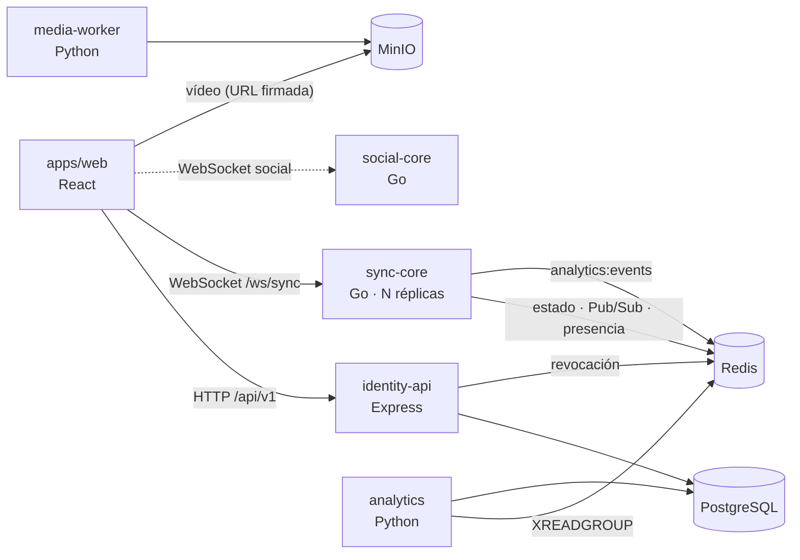
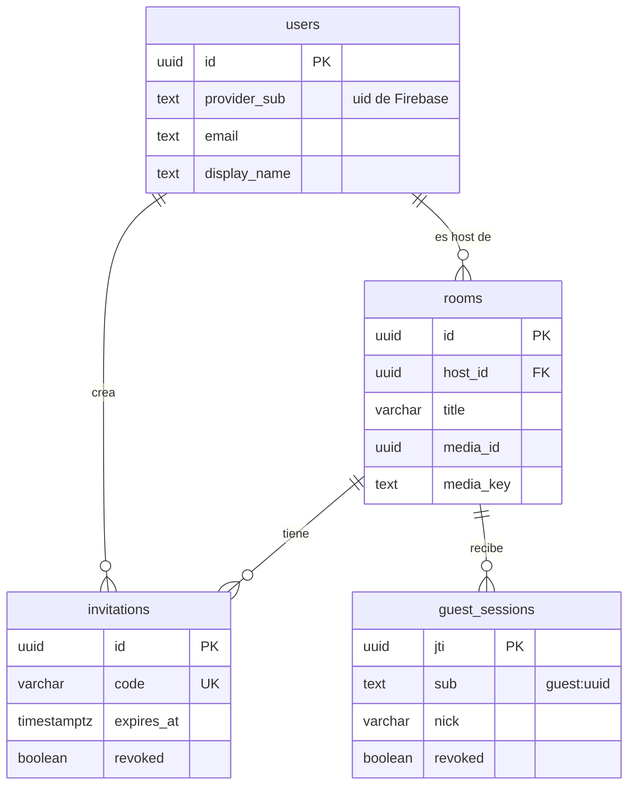

<div align="center">

# ✨ TINT — Watch Party Experience
### *Synchronized, Social & Immersive Cinema Platform*

[](https://github.com/HanamDavid/tint-monorepo/actions/workflows/ci-pipeline.yml)


<p align="center">
  <b>TINT</b> redefine la forma de ver contenido compartido en internet. Combina sincronización de vídeo de sub-segundo, iluminación ambiental <b>Ambilight</b> en vivo, mapas de calor sociales y trivias competitivas en una interfaz oscura, sobria y de lujo.
</p>

</div>

---

## 🌌 Características Principales

* ⏱️ **Core Sync (Golang):** Reproducción sincronizada multicanal mediante WebSockets con corrección automática de desfase (*drift*) (< 500 ms). Ver [Dominio de Reproducción](docs/dominio-reproduccion.md).
* 🌈 **Efecto Ambilight en Vivo:** Extracción de paleta de colores fotograma a fotograma proyectada como sombra ambiental difuminada.
* 👏 **Gamificación & Heatmaps:** Reacciones expresivas con *throttling* anti-spam (máx. 5/s), histogramas de emoción en la barra de tiempo y trivias con bonificación por velocidad.
* 📊 **Analítica Privacy-First:** Ingesta desacoplada en Redis Streams con cumplimiento estricto de la Ley 1581 (sin almacenamiento de conversaciones).
* 🔐 **Identidad sin fricción:** el Host entra con Google (Firebase) y los invitados se unen con un link y un apodo, sin crear cuenta. El Host puede retirar invitados en vivo. Ver [Usuarios, identidad y permisos](docs/usuarios-e-identidad.md).

---

## 🛠️ Arquitectura Monorepo



Detalle completo, contratos entre dominios y estado de cada servicio en [docs/arquitectura.md](docs/arquitectura.md).

| Servicio | Dominio | Tecnologías |
| :--- | :--- | :--- |
| [`apps/web`](apps/web) | UI/UX & Cliente Web | React, TypeScript, Tailwind CSS, Vitest |
| [`services/identity-api`](services/identity-api) | Usuarios, Salas, Invitaciones & Tokens | TypeScript, Express, PostgreSQL (Drizzle), Firebase Auth |
| [`services/sync-core`](services/sync-core) | Sincronización & Reloj Maestro | Golang, WebSockets (`coder/websocket`), Redis Pub/Sub |
| [`services/media-worker`](services/media-worker) | Inspección de Vídeo & Ambilight | Python 3.11, FFmpeg, ffprobe, MinIO |
| [`services/social-core`](services/social-core) | Chat, Reacciones & Trivias | Golang, Redis Sorted Sets |
| [`services/analytics`](services/analytics) | Telemetría & KPIs Diferidos | Python, Redis Streams (`XREADGROUP`), SQL |

```text
tint-monorepo/
├── .github/workflows/      # ci-pipeline.yml · cd-deploy.yml
├── apps/
│   └── web/                # Frontend (React + TS + Tailwind)
├── services/
│   ├── identity-api/       # Usuarios, salas y tokens HS256 (TypeScript)
│   ├── sync-core/          # Sincronización y hosts (Go)
│   ├── social-core/        # Gamificación e inmersión (Go)
│   ├── media-worker/       # Worker de media (Python + FFmpeg)
│   └── analytics/          # Analítica & insights (Python + SQL)
├── docs/                   # Documentación de features (diagramas Mermaid)
├── scripts/                # Utilidades de CI (gate de cobertura Go)
├── docker-compose.yml      # Entorno local (PostgreSQL, Redis, MinIO)
├── Makefile
└── AGENTS.md               # Guía raíz → cada dominio tiene su propio AGENTS.md
```

---

## 👤 Usuarios y Roles

| Rol | Quién es | Cómo se autentica | Qué puede hacer |
| :--- | :--- | :--- | :--- |
| **Host** | Usuario registrado, dueño de la sala | Google vía Firebase (ID token RS256) + *sync-ticket* HS256 para el Canal Sync | Crear salas e invitaciones, asignar el vídeo, controlar la reproducción, retirar invitados |
| **Cohost** | Usuario registrado con permiso de control | *Previsto:* sync-core ya acepta `role: cohost`, pero aún no se emite | Controlar la reproducción |
| **Invitado** | Anónimo, con un apodo | *Guest token* HS256 (4 h) al reclamar `/invite/:code` | Ver la sala sincronizada |
| **Invitado con control delegado** | Un invitado elegido por sync-core si el Host no vuelve en 5 min | Su mismo guest token | Controlar la reproducción hasta que vuelva el Host |



Esquemas completos de tablas y tokens, matriz de permisos y flujos de login, invitación y retiro en **[docs/usuarios-e-identidad.md](docs/usuarios-e-identidad.md)**.

---

## 📚 Documentación

| Documento | Contenido |
| :--- | :--- |
| [docs/arquitectura.md](docs/arquitectura.md) | Servicios, almacenes de datos, contratos entre dominios, puertos y CI |
| [docs/usuarios-e-identidad.md](docs/usuarios-e-identidad.md) | Roles, permisos, esquema de PostgreSQL, tokens y flujos de identidad |
| [docs/dominio-reproduccion.md](docs/dominio-reproduccion.md) | Canal Sync v2: Reloj Maestro, drift, presencia, delegación, métricas y pruebas |
| [AGENTS.md](AGENTS.md) | Reglas del monorepo, contratos compartidos, flujo de trabajo y gates por dominio |

> [!TIP]
> Cada dominio incluye un `AGENTS.md` con su stack, responsabilidades, límites, modelo de datos y reglas TDD. Léelo antes de contribuir (humano o agente IA).

---

## 🚀 Inicio Rápido en Local

**Requisitos:** Docker, Go 1.22+, Python 3.11+, Node.js 22+.

```bash
# 1. Clonar el repositorio
git clone https://github.com/HanamDavid/tint-monorepo.git
cd tint-monorepo

# 2. Levantar la infraestructura base (PostgreSQL, Redis, MinIO + bucket) y sync-core
cp .env.example .env
docker compose up -d

# 3. identity-api: dependencias, migraciones y servidor (:8081)
cd services/identity-api
cp .env.example .env            # define FIREBASE_PROJECT_ID
npm ci && npx drizzle-kit migrate && npm run dev

# 4. web (:5173), en otra terminal
cd apps/web
cp .env.example .env            # credenciales de Firebase del cliente
npm ci && npm run dev

# 5. Suite global de pruebas (TDD Policy Check)
make test-all
```

| Servicio local | URL |
| :--- | :--- |
| PostgreSQL | `localhost:5432` |
| Redis | `localhost:6379` |
| MinIO API / Consola | `localhost:9000` / [`localhost:9001`](http://localhost:9001) |
| sync-core (Canal Sync) | `ws://localhost:8082/ws/sync` · `/healthz` · `/metrics` (Prometheus) |
| identity-api (`npm run dev`) | `http://localhost:8081/api/v1` |
| web (`npm run dev`) | `http://localhost:5173` |

> [!NOTE]
> `JWT_SECRET` (en `.env`) debe ser el mismo para identity-api y sync-core: identity-api firma los tokens del Canal Sync y sync-core los verifica.

---

## 🧪 Política TDD y Cobertura

> [!IMPORTANT]
> Todo cambio en la plataforma exige metodología TDD (Red → Green → Refactor) y una cobertura de pruebas automatizadas **≥ 85%**. Los Pull Requests sin pruebas suficientes son rechazados automáticamente por el pipeline de CI.

El workflow [`ci-pipeline.yml`](.github/workflows/ci-pipeline.yml) se ejecuta en cada push y PR hacia `main` y `develop`, en paralelo:

| Job | Comando | Gate |
| :--- | :--- | :--- |
| Go (`sync-core`, `social-core`) | `go test -race -coverprofile=coverage.out ./...` | `scripts/check-go-coverage.sh` |
| Python (`media-worker`, `analytics`) | `pytest --cov=src` | `--cov-fail-under=85` |
| Web (`apps/web`) | `vitest run --coverage` | `thresholds` en `vitest.config.ts` |
| Node (`identity-api`) | `npm ci` · `tsc` · `vitest run --coverage` | `thresholds` en `vitest.config.ts` |
| k6 (`sync-core`) | 50 conexiones reales contra sync-core + Redis | p99 de retransmisión < 100 ms, drift y autorización |

El job **`CI Gate`** agrega el resultado de todos los anteriores y es el *status check* requerido por la protección de ramas: si cualquier servicio falla o baja del 85%, el merge queda bloqueado.

---

## 🤝 Contribución

1. Lee el [AGENTS.md](AGENTS.md) raíz y el del dominio.
2. Crea una rama desde `develop`: `feat/<dominio>-<descripcion>`.
3. Prueba primero (TDD), luego implementa y corre el gate del dominio.
4. Commits con [Conventional Commits](https://www.conventionalcommits.org/es/v1.0.0/): `feat(sync-core): ...`, `fix(identity-api): ...`, `docs(web): ...`, `ci: ...`.
5. Si cambió un flujo o un contrato, actualiza [`docs/`](docs/README.md).
6. Abre **un PR por dominio** hacia `develop` y completa la plantilla.

## 📄 Licencia

Distribuido bajo licencia [MIT](LICENSE).
