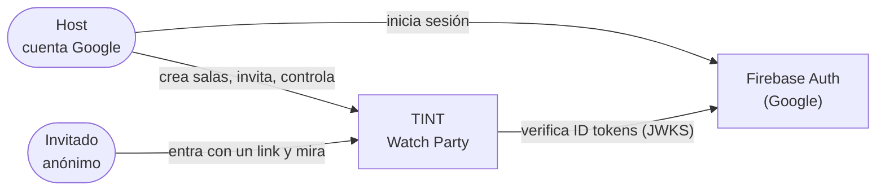
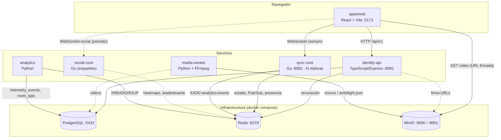
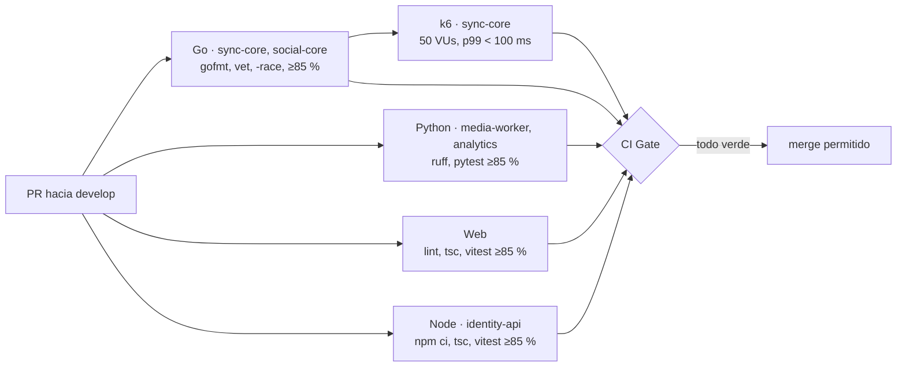

# 🏛️ Arquitectura del sistema

> Vista general de TINT: servicios, almacenes de datos, contratos compartidos y estado de implementación.
> Los detalles de cada feature están en sus propios documentos (ver [índice](README.md)).

## 1. Contexto

## 2. Contenedores

## 3. Servicios y estado

| Servicio | Responsabilidad | Estado | Guía |
| :--- | :--- | :--- | :--- |
| `apps/web` | UI: login, dashboard, crear sala, invitación, sala con reproductor sincronizado | ✅ Implementado (chat local, social pendiente) | [AGENTS](../apps/web/AGENTS.md) |
| `services/identity-api` | Usuarios, salas, invitaciones, tokens, vídeo de la sala, invitados | ✅ Implementado | [AGENTS](../services/identity-api/AGENTS.md) |
| `services/sync-core` | Reloj Maestro, Canal Sync, drift, presencia, delegación | ✅ Implementado (v2) | [AGENTS](../services/sync-core/AGENTS.md) |
| `services/social-core` | Chat, reacciones, heatmaps, trivias | 🟡 Esqueleto (limitador y puntaje) | [AGENTS](../services/social-core/AGENTS.md) |
| `services/media-worker` | `ffprobe`, Ambilight, subida a MinIO | 🟡 Núcleo (probe y ambilight) | [AGENTS](../services/media-worker/AGENTS.md) |
| `services/analytics` | Ingesta de `analytics:events`, sanitización, KPIs | 🟡 Núcleo (sanitize y KPIs) | [AGENTS](../services/analytics/AGENTS.md) |

## 4. Almacenes de datos

| Almacén | Dueño | Contenido principal |
| :--- | :--- | :--- |
| PostgreSQL | identity-api | `users`, `rooms`, `invitations`, `guest_sessions` ([esquema](usuarios-e-identidad.md#3-esquema-de-datos-postgresql)) |
| PostgreSQL | media-worker / analytics | `videos`, `telemetry_events`, `room_kpis` (según sus guías) |
| Redis | sync-core | `room:{id}:*` (estado, Pub/Sub, presencia, delegación) ([modelo](dominio-reproduccion.md#7-modelo-de-datos-en-redis)) |
| Redis | identity-api → sync-core | `token:revoked:{jti}` |
| Redis Stream | todos → analytics | `analytics:events` |
| MinIO | media-worker / identity-api | Bucket `tint-media`: vídeos y `ambilight.json` |

## 5. Contratos compartidos entre dominios

Son los únicos puntos en los que un PR puede necesitar coordinar dos dominios (regla 1 de [AGENTS.md](../AGENTS.md)). Si se cambia uno, hay que actualizar **ambos lados y este documento**.

| Contrato | Productor → consumidor | Definición |
| :--- | :--- | :--- |
| JWT HS256 (guest token, sync-ticket) | identity-api → sync-core | [usuarios-e-identidad §4](usuarios-e-identidad.md#4-esquemas-de-tokens) · `JWT_SECRET`/`JWT_ISSUER`/`JWT_AUDIENCE` iguales en ambos |
| Protocolo del Canal Sync v2 | sync-core ↔ web | [sync-core/AGENTS.md](../services/sync-core/AGENTS.md#protocolo-del-canal-sync) |
| Revocación (`token:revoked:{jti}` + `REVOKED`) | identity-api → sync-core | [dominio-reproduccion §6.6](dominio-reproduccion.md#66-retirar-a-un-invitado-f5) |
| `mediaId` / `media_id` | identity-api → web → sync-core | [dominio-reproduccion §6.7](dominio-reproduccion.md#67-cambio-de-vídeo-f3--load) |
| API REST `/api/v1` | identity-api → web | [identity-api/AGENTS.md](../services/identity-api/AGENTS.md#api) |
| `analytics:events` | sync-core, social-core → analytics | Campos obligatorios `event_id`, `type`, `room_id`, `occurred_at`; sin PII |

## 6. Puertos locales

| Servicio | Puerto | Notas |
| :--- | :--- | :--- |
| web | 5173 | `npm run dev` |
| identity-api | 8081 | `npm run dev` |
| sync-core | 8082 → 8080 | `docker compose` (`/ws/sync`, `/healthz`, `/metrics`) |
| PostgreSQL | 5432 | |
| Redis | 6379 | |
| MinIO | 9000 (API) · 9001 (consola) | |

## 7. Calidad y CI

