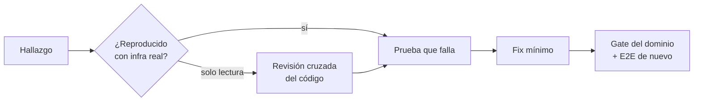

# Bug hunting de punta a punta (octubre 2026)

Revisión del flujo completo **subir vídeo → reproducir → sala en vivo con amigos** sobre `develop` (`b5dae64`), con la infraestructura real levantada (`docker compose`: PostgreSQL, Redis, MinIO, sync-core, social-core; identity-api y la web en local).

## 1. Cómo se probó

| Prueba | Qué cubre | Resultado |
| :--- | :--- | :--- |
| `tests/integration/live-room.int.test.ts` (identity-api, `INTEGRATION=1`) | Autorización entre salas y roles, comandos del Canal Sync, chat, reacciones, historial, presencia del host, revocación y borrado de sala contra los servicios reales | Encontró los bugs B1, B2 y B4 |
| Navegador real (Chromium headless + Playwright) | Invitado canjea el link en la UI, ve el vídeo firmado desde MinIO y lo sigue mientras un host manda `PLAY`/`SEEK`/`PAUSE`/`RATE`; chat, reacción 😢, recarga y salida del host | Sincronía dentro de tolerancia (±0,1 s); sin bugs funcionales en el camino feliz |
| WebSocket manual contra social-core | Token falsificado y reloj del cliente adelantado | Confirmó B3 y B5 |
| Revisión de código por dominio | identity-api, web, sync-core y social-core | Hallazgos de la tabla de abajo |

## 2. Hallazgos y plan

Severidad: **A** alta (seguridad o flujo roto), **M** media, **B** baja.

### Seguridad y permisos
| # | Sev. | Dominio | Hallazgo | Evidencia | Plan |
| :--- | :--- | :--- | :--- | :--- | :--- |
| B3 | A | social-core | Un token Firebase **falsificado** (firma inventada) abre `/ws/social` y chatea suplantando a cualquiera en cualquier sala: el respaldo de host no verifica la firma RS256 | Reproducido: entró como "Host Falso" | Verificar RS256 contra los certificados públicos de Google (por `kid`, con caché); fallar cerrado |
| B1 | A | social-core | Un invitado **retirado** por el host sigue en el chat y puede reconectar | E2E | Leer `jti`, comprobar `token:revoked:{jti}` en el handshake y cerrar sockets vivos al recibir `REVOKED` |
| B2 | M | identity-api | **Borrar la sala** no corta a quien ya está dentro (sync y chat) | E2E | Al borrar, revocar todas las sesiones de invitado activas (misma vía que el retiro: `token:revoked` + `REVOKED`) |
| B6 | M | identity-api | El sync-ticket usa el **email del host como nick** si no tiene nombre: se difunde a toda la sala | Código | Nick = nombre, o la parte local del email, o "Host" |
| B7 | M | identity-api | `MAX_UPLOAD_BYTES` se evade declarando un tamaño menor: la URL PUT no fija el tamaño y `complete` no lo comprueba | Código | `complete` compara el tamaño real (HEAD) con el declarado y el máximo |
| B8 | B | social-core | Con `JWT_SECRET` vacío arranca y verifica con clave vacía; `OriginPatterns: *` | Código | No arrancar sin secreto; `ALLOWED_ORIGINS` como sync-core |

### Flujo roto o datos inconsistentes
| # | Sev. | Dominio | Hallazgo | Evidencia | Plan |
| :--- | :--- | :--- | :--- | :--- | :--- |
| B5 | A | social-core | Si el reloj del navegador va **adelantado**, el chat y las reacciones se descartan en silencio (`INVALID_PAYLOAD`) | Reproducido con +2 s | No comparar relojes distintos (como sync-core); acotar `occurred_at` futuro |
| B9 | A | web | El ID token de Firebase del host **no se renueva**: a la hora, sync-ticket, playback y chat dan 401 y la sala queda en "Reconectando…" para siempre | Código | `onIdTokenChanged` + token fresco por petición; ante 401, a `/login?next=` |
| B10 | A | web | Token de invitado de **otra sala o expirado**: bucle de reconexión y título/link de la sala anterior | Código | Validar `room_id` y `exp` del token antes de entrar; si no, la puerta |
| B11 | M | web + sync-core | Invitado retirado mientras tenía la pestaña cerrada: el handshake se rechaza antes del upgrade (1006) y la web reintenta sin fin | Código | sync-core cierra con 4001 (revocado) / 4003 (expirado) tras el upgrade; la web trata el 401 del playback como invitación inválida |
| B12 | A | identity-api | **Usuarios duplicados** en el primer login concurrente (no hay `UNIQUE (provider, provider_sub)`); el host puede acabar con otro id y sin sus salas | Código | Índice único (migración 0005) + `INSERT … ON CONFLICT` atómico que además refresca el perfil |
| B13 | M | identity-api | `complete` no es idempotente: reintentos encolan el vídeo varias veces y devuelven un vídeo `ready` a `processing` | Código | Encolar solo en la transición `pending → processing` |
| B14 | M | web | El host que abre "Ver invitación" de su sala y la canjea **pierde la sesión de host** sin aviso | Código | Botón "Entrar a la sala" tras crearla; confirmar antes de bajar a invitado |
| B15 | M | web | El botón "Unirse a la reproducción" puede reproducir aunque la sala esté en pausa | Código | Limpiar el aviso al pausar; reproducir solo si la sala reproduce |
| B16 | M | web | El host que abre una sala ajena reintenta el sync-ticket (403) para siempre | Código | No reintentar en 403/404/410 y explicar el motivo |
| B17 | M | social-core | Conexiones muertas nunca se detectan (sin ping ni timeouts): goroutines colgadas y presencia fantasma | Código | Ping periódico y timeout por escritura |
| B18 | B | identity-api | Título > 150 caracteres o `ttlHours` enorme → 500 que además filtra el texto del error de PostgreSQL | Código | Validación en zod y error genérico |

### Robustez y detalles
| # | Sev. | Dominio | Hallazgo | Plan |
| :--- | :--- | :--- | :--- | :--- |
| B19 | B | sync-core | `ALLOWED_ORIGINS` por defecto rechaza `http://127.0.0.1:5173` | Añadirlo al valor por defecto |
| B20 | B | sync-core | El TTL de 12 h del estado no se renueva si nadie manda comandos | Renovarlo en el barrido periódico |
| B21 | B | sync-core | Un cliente que perdió un broadcast queda con estado/vídeo viejo: `SYNC_CORRECTION` solo trae la posición | Incluir `status`, `rate` y `media_id` (campos opcionales, compatibles) |
| B22 | B | social-core | Memoria sin límite (presencia y buckets de reacciones) y reacciones que no cruzan réplicas | Podar entradas y reenviar reacciones por el relay |
| B23 | B | web | `?next=` perdido en `ProtectedRoute`; `VITE_SOCIAL_WS_URL` sin documentar; "Volver" del invitado lleva al login; participantes sin refresco; sin favicon (404) | Ajustes puntuales |
| B24 | B | identity-api | `POST /invitations/:code/revoke` responde 403 cuando la sala no existe | 404 |

## 3. Pendiente de acordar (no se toca en esta rama)

| Tema | Por qué no se arregla aquí |
| :--- | :--- |
| **Contrato identity-api → media-worker.** La rama `feat/media-worker-probe` (`c10d595`, 11-10-2026) retiró el consumidor de `media:uploads`: ahora una API llama a `process_video(video_id, archivo_local)` y el worker sube el archivo. Con `develop` + esa rama, los vídeos subidos quedarían en `pending` para siempre y sin Ambilight (la reproducción sí funciona) | Es un cambio de contrato entre dominios en una rama ajena sin fusionar. Hay que decidir entre (a) mantener el stream y que el worker descargue `storage_key` del bucket, o (b) que identity-api llame al worker. Ver [dominio-reproduccion §6.7](dominio-reproduccion.md#67-subida-y-cambio-de-vídeo) |
| `PUT /rooms/:id/media` acepta cualquier clave del bucket | Endpoint heredado del flujo manual; restringirlo a vídeos de la sala cambia la API pública de la web |
| sync-core mantiene `Hub.mu` durante `Subscribe`/`Unsubscribe` de Redis | Refactor de concurrencia con riesgo; solo afecta mientras Redis reconecta |
| Fallos de infraestructura que responden 401/403/500 en vez de 503 | Cambio transversal de semántica de errores |
