# ⏱️ Dominio de Reproducción — Canal Sync

> Documento técnico de la feature de reproducción sincronizada de TINT: qué se construyó, cómo funciona, qué se integró en cada dominio y cómo se verificó.
> Rama: `feat/reproductor` · Servicio principal: [`services/sync-core`](../services/sync-core) · Protocolo detallado: [`services/sync-core/AGENTS.md`](../services/sync-core/AGENTS.md).

## Índice
1. [Resumen](#1-resumen)
2. [Requisitos cubiertos](#2-requisitos-cubiertos)
3. [Vista general](#3-vista-general)
4. [Mapa de cambios por dominio](#4-mapa-de-cambios-por-dominio)
5. [El Reloj Maestro](#5-el-reloj-maestro)
6. [Flujos principales](#6-flujos-principales)
7. [Modelo de datos en Redis](#7-modelo-de-datos-en-redis)
8. [Arquitectura interna de sync-core](#8-arquitectura-interna-de-sync-core)
9. [Cliente web](#9-cliente-web)
10. [Seguridad y límites](#10-seguridad-y-límites)
11. [Configuración y ejecución local](#11-configuración-y-ejecución-local)
12. [Verificación y resultados](#12-verificación-y-resultados)
13. [Decisiones de diseño y desviaciones del plan](#13-decisiones-de-diseño-y-desviaciones-del-plan)
14. [Limitaciones conocidas](#14-limitaciones-conocidas)

---

## 1. Resumen

TINT es una *Watch Party*: todos los participantes de una sala deben ver **el mismo fotograma al mismo tiempo**. Esta feature implementa el *Core Sync Domain* completo:

- **sync-core (Go)**: servidor WebSocket `/ws/sync` con Reloj Maestro en Redis, comandos `PLAY`/`PAUSE`/`SEEK` autorizados por rol, difusión entre réplicas por Redis Pub/Sub, medición de RTT y corrección de *drift*, presencia del Host y telemetría no bloqueante.
- **identity-api (TypeScript)**: endpoint `POST /api/v1/rooms/:id/sync-ticket` que emite un token HS256 de vida corta para que el Host entre al Canal Sync.
- **web (React)**: hook `useSyncSocket` y componente `SyncedPlayer` integrados en la página `WatchRoom`.
- **infraestructura**: servicio `sync-core` en `docker-compose.yml`, variables en `.env.example`, caché de dependencias Go en CI y prueba de carga k6.

### Commits de la rama

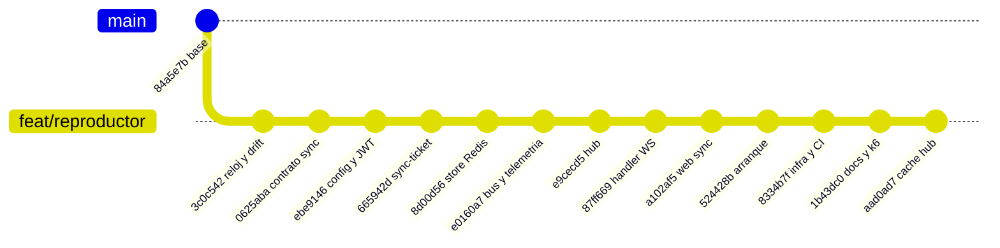

| Commit | Alcance | Contenido |
| :--- | :--- | :--- |
| `3c0c542` | sync-core | `internal/master` (ancla, `PositionAt`, `Apply`) e `internal/drift` (EWMA de RTT, umbrales). |
| `0625aba` | sync-core | Contrato `syncevent.Event` extendido: tipos, códigos de error, `Validate`/`ValidateInbound`, claves Redis. |
| `ebe9146` | sync-core | `internal/config` y `internal/auth` (verificación HS256, roles). |
| `665942d` | identity-api | `generateSyncTicket` + ruta `POST /rooms/:id/sync-ticket`. |
| `8d00d56` | sync-core | `internal/store`: estado con `WATCH/MULTI/EXEC`, dedupe, presencia de hosts. |
| `e0160a7` | sync-core | `internal/bus` (Pub/Sub) e `internal/telemetry` (`XADD analytics:events`). |
| `e9cecd5` | sync-core | `internal/hub`: salas, comandos, heartbeat, drift y `HOST_STATUS`. |
| `87ff669` | sync-core | `internal/ws`: handshake JWT, goroutines lectora/escritora, códigos de cierre. |
| `a102af5` | web | `syncProtocol.ts`, `drift.ts`, `useSyncSocket`, `SyncedPlayer`, integración en `WatchRoom`. |
| `524428b` | sync-core | `internal/server.Run`: Redis, ensamblado y apagado ordenado; `main.go` mínimo. |
| `8334b7f` | sync-core | Dockerfile, `docker-compose.yml`, `.env.example`, caché de CI. |
| `1b43dc0` | sync-core | Protocolo en `AGENTS.md` y prueba de carga `loadtest/sync.js`. |
| `aad0ad7` | sync-core | Caché del estado por sala en el hub (elimina un `HGETALL` por latido). |

---

## 2. Requisitos cubiertos

| Requisito | Descripción | Implementación |
| :--- | :--- | :--- |
| **HU-SYNC-01** | Canal `/ws/sync?room_id=X` aislado, estado inmediato al conectar | `internal/ws` + `hub.Connect` envía `STATE` antes de cualquier otro mensaje. |
| **REQ-27 / HU-SYNC-02** | `PLAY`/`PAUSE`/`SEEK` del Host a todos en < 100 ms; participantes sin control | `hub.Handle` → `store.Apply` (transacción + `PUBLISH`) → `bus` → todas las réplicas. Participante → `ERROR{FORBIDDEN}`. Medido: 2–4 ms extremo a extremo. |
| **REQ-28 / HU-SYNC-03** | Drift > 500 ms compensando RTT, corrección suave y métrica | `internal/drift`: estrategia `rate` (±5 %) o `seek`; `sync_drift` a `analytics:events`. |
| **REQ-07** | La sala sobrevive 12 h si el Host se cae | TTL de 12 h refrescado en cada comando, conexión y desconexión; la reproducción sigue el reloj sin conexiones. |
| **REQ-08 / SYNC-BE-05** | Escalado horizontal entre réplicas | Toda difusión pasa por Redis Pub/Sub; presencia de hosts en un ZSET compartido. |
| **SYNC-BE-01..04** | Handshake JWT, Reloj Maestro, comandos, RTT/drift | Paquetes `auth`, `master`, `store`, `drift`. |
| **SYNC-TEST-01** | 500 conexiones simultáneas | `loadtest/sync.js` (k6). Ver [resultados](#12-verificación-y-resultados). |
| **Ley 1581** | Analítica sin PII | `telemetry.DriftSample` no lleva `sub`, `nick` ni token. |

---

## 3. Vista general

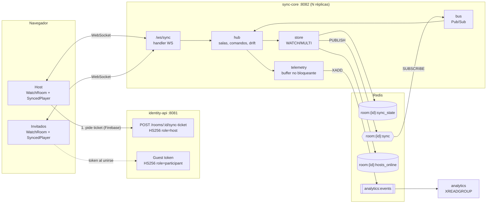

**Idea central:** sync-core no guarda "el segundo actual" ni usa temporizadores. Guarda un **ancla** (posición + instante del servidor + velocidad) y cualquiera puede calcular la posición en cualquier momento. Cada comando es una sola escritura atómica que además publica el cambio para todas las réplicas.

---

## 4. Mapa de cambios por dominio

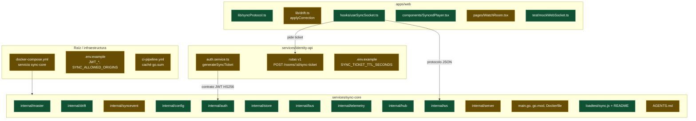

🟩 nuevo · 🟨 modificado

| Dominio | Qué se integró |
| :--- | :--- |
| **sync-core** | Servicio completo (antes solo tenía `/healthz` y el contrato `Event`). |
| **identity-api** | Sync-ticket del Host con `role: host`, `jti`, `exp = ahora + SYNC_TICKET_TTL_SECONDS` (600 s); el guest token ahora fija HS256 explícitamente. Solo el dueño de la sala obtiene ticket (`requireAuthHost` + `requireRoomOwner`). |
| **web** | Cliente del Canal Sync que reemplaza el `TODO /ws/sync` de `WatchRoom`; el vídeo sale de `VITE_DEMO_VIDEO_URL`. |
| **infra** | `sync-core` en `docker compose` (puerto `8082`), dependencias Go cacheadas en CI. |

---

## 5. El Reloj Maestro

El estado de cada sala es un ancla:

| Campo | Significado |
| :--- | :--- |
| `status` | `playing` o `paused` |
| `position_ms` | Posición del vídeo **en el instante del ancla** |
| `updated_at_ms` | Instante del ancla, reloj del **servidor** (unix ms) |
| `rate` | Velocidad (1.0) |
| `version` | Contador monotónico: orden total de comandos |
| `host_id` | `sub` del último Host conectado |

```text
PositionAt(t) = position_ms + (t − updated_at_ms) × rate   si playing
              = position_ms                                 si paused
```

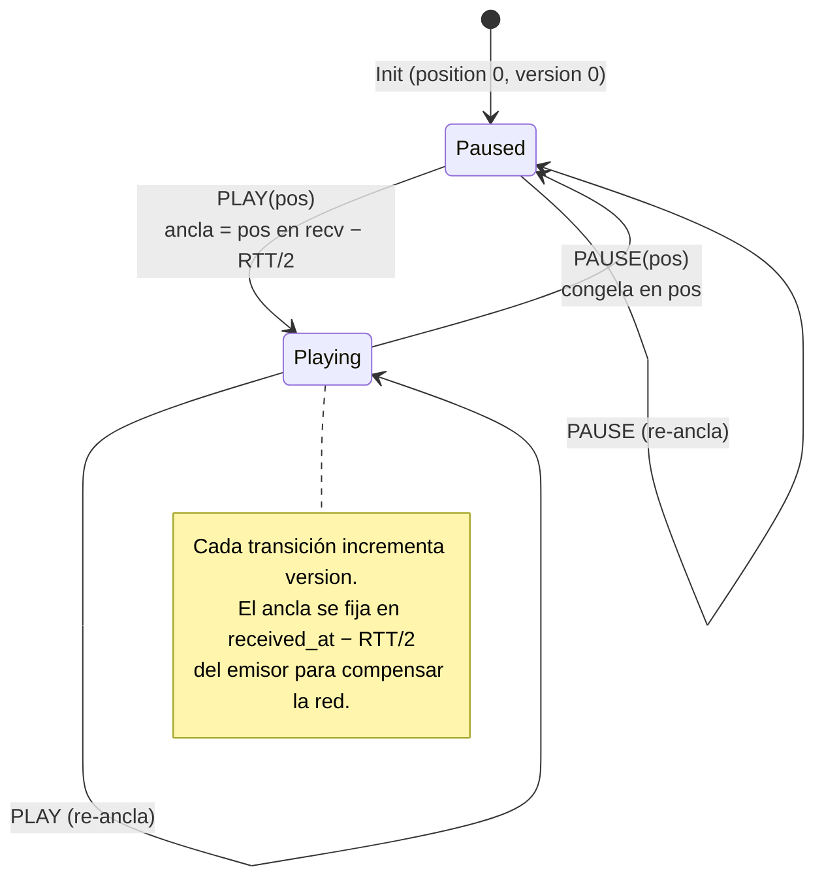

`master.Apply` es una función pura (sin I/O) y es **la única** que calcula el siguiente estado; Redis solo lo persiste.

---

## 6. Flujos principales

### 6.1 Conexión (handshake)

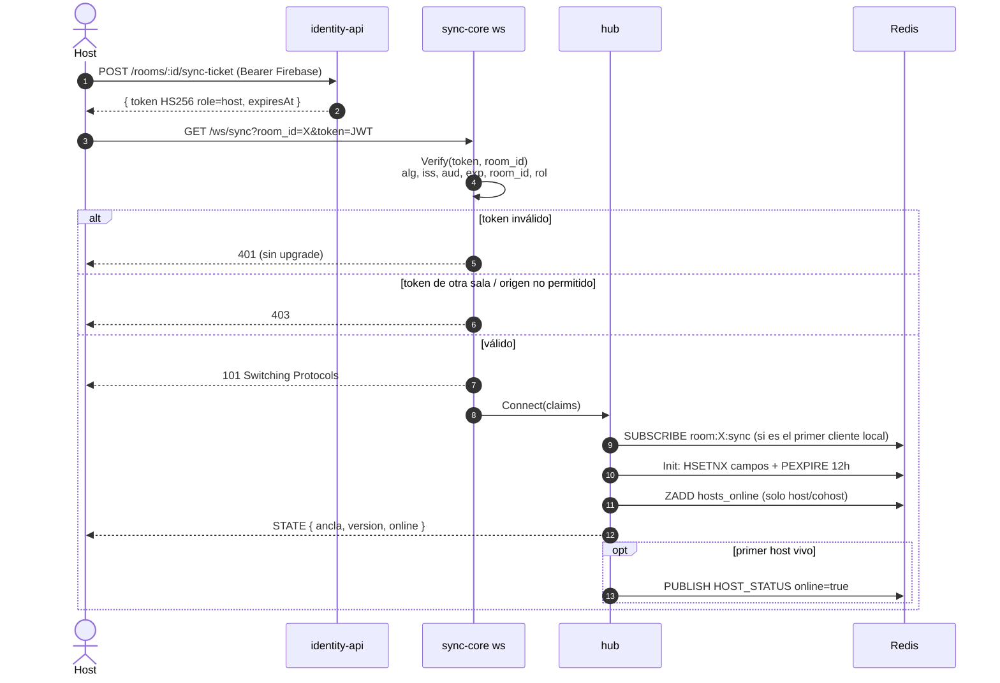

Los invitados siguen el mismo flujo con el guest token que emite identity-api al unirse (rol `participant`).

### 6.2 Comando del Host (PLAY / PAUSE / SEEK) entre réplicas

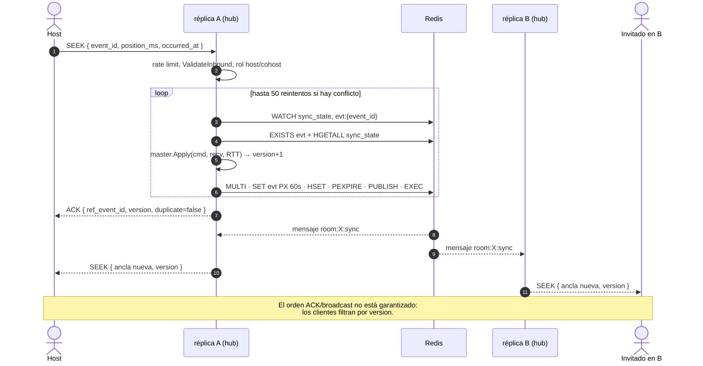

- Un **participante** que envía un comando recibe `ERROR{FORBIDDEN}` y el estado no cambia.
- Un `event_id` repetido (reintento tras reconexión) recibe `ACK{duplicate:true}` y no se difunde.
- La réplica emisora **no** difunde localmente: todos reciben el cambio por Pub/Sub, así hay un único camino y el mismo orden en todas las réplicas.

### 6.3 Heartbeat, RTT y drift

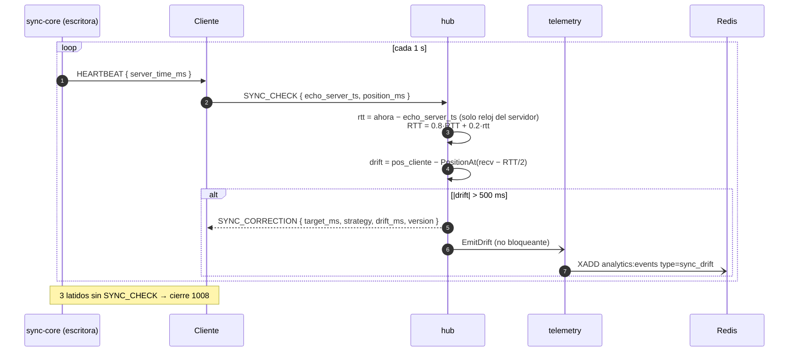

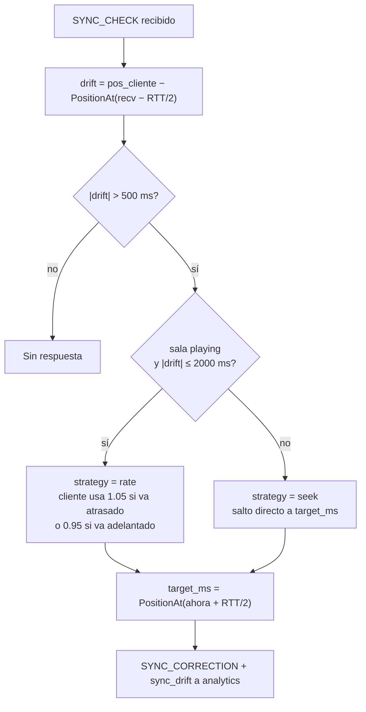

El RTT se mide **solo con el reloj del servidor** (el cliente devuelve el `server_time_ms` que recibió), así que un reloj de cliente adelantado o atrasado no afecta el cálculo.

### 6.4 Presencia y caída del Host (REQ-07)

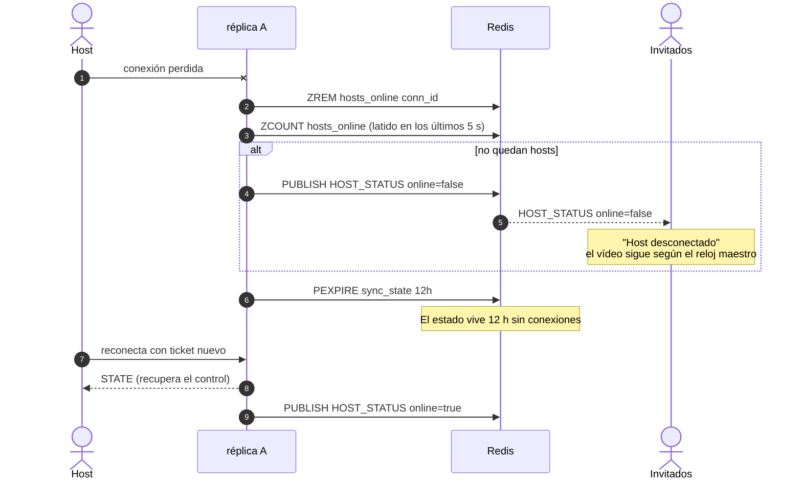

Si una réplica muere sin ejecutar `HostGone`, su entrada en el ZSET deja de contar a los 5 s porque el score es el último latido.

### 6.5 Ciclo de vida de una conexión

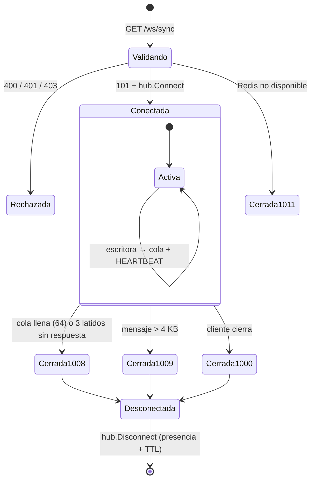

---

## 7. Modelo de datos en Redis

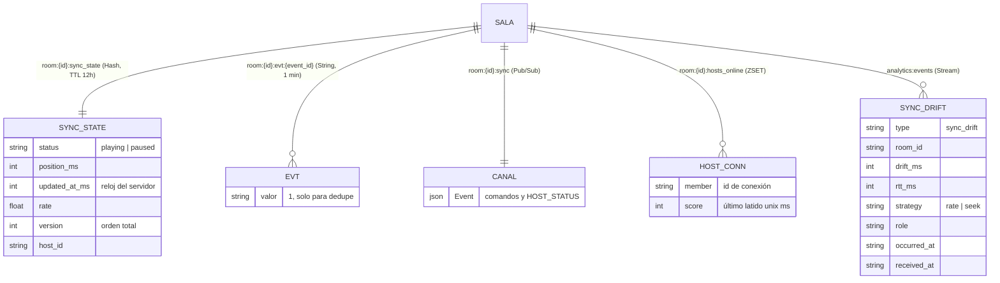

| Clave | Escrita por | Vida |
| :--- | :--- | :--- |
| `room:{id}:sync_state` | `store.Init`, `store.Apply`, `store.Touch` | 12 h desde la última actividad |
| `room:{id}:evt:{event_id}` | `store.Apply` | 1 min |
| `room:{id}:sync` | `store.Apply` (comandos), `hub` (`HOST_STATUS`) | efímero |
| `room:{id}:hosts_online` | `HostSeen` al conectar y en cada `SYNC_CHECK` de host; `HostGone` | 12 h; miembros cuentan 5 s desde su último latido |
| `analytics:events` | `telemetry.Run` | `MAXLEN ~100000` |

---

## 8. Arquitectura interna de sync-core

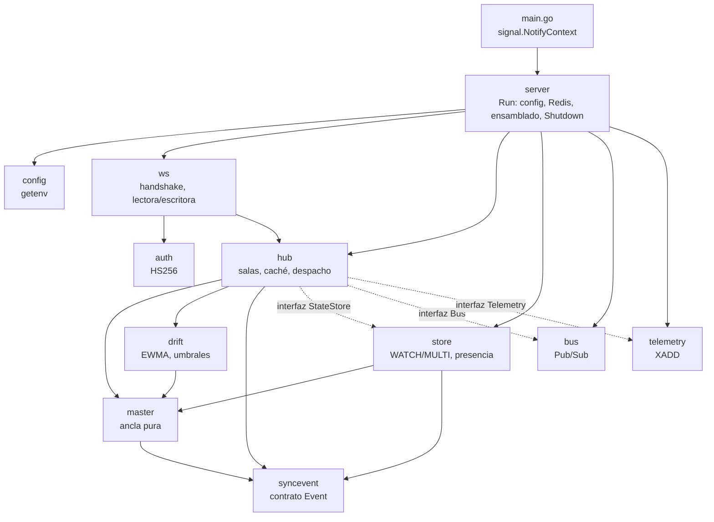

El hub depende de **interfaces** (`StateStore`, `Bus`, `Telemetry`), lo que permitió probarlo con dobles y con miniredis sin levantar Redis real.

### Concurrencia por conexión

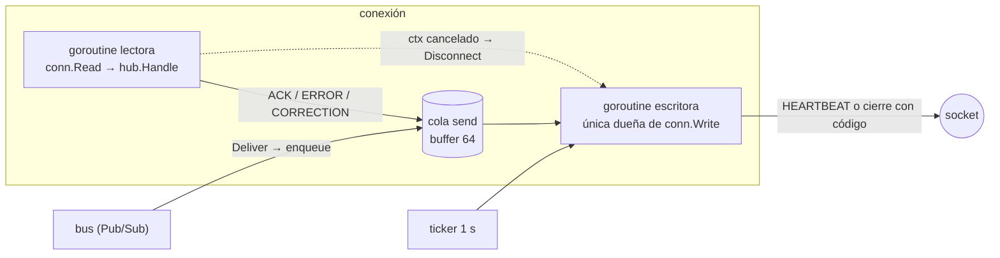

- `enqueue` **nunca bloquea**: si la cola de un cliente está llena se le desconecta (`1008`) y, al reconectar, recibe `STATE`. Un cliente lento no frena a los otros 499.
- Solo la escritora escribe y cierra el socket, con un código explícito; la lectora termina cuando el socket se cierra.
- **Caché por sala** (`aad0ad7`): el hub guarda el último estado de cada sala, lo actualiza con `Init` y con cada broadcast recibido (solo si la `version` es mayor) y lo refresca desde Redis cada 5 s. Antes, cada `SYNC_CHECK` hacía un `HGETALL`: con 500 clientes eran 500 lecturas/s por sala que competían con los comandos del Host.

---

## 9. Cliente web

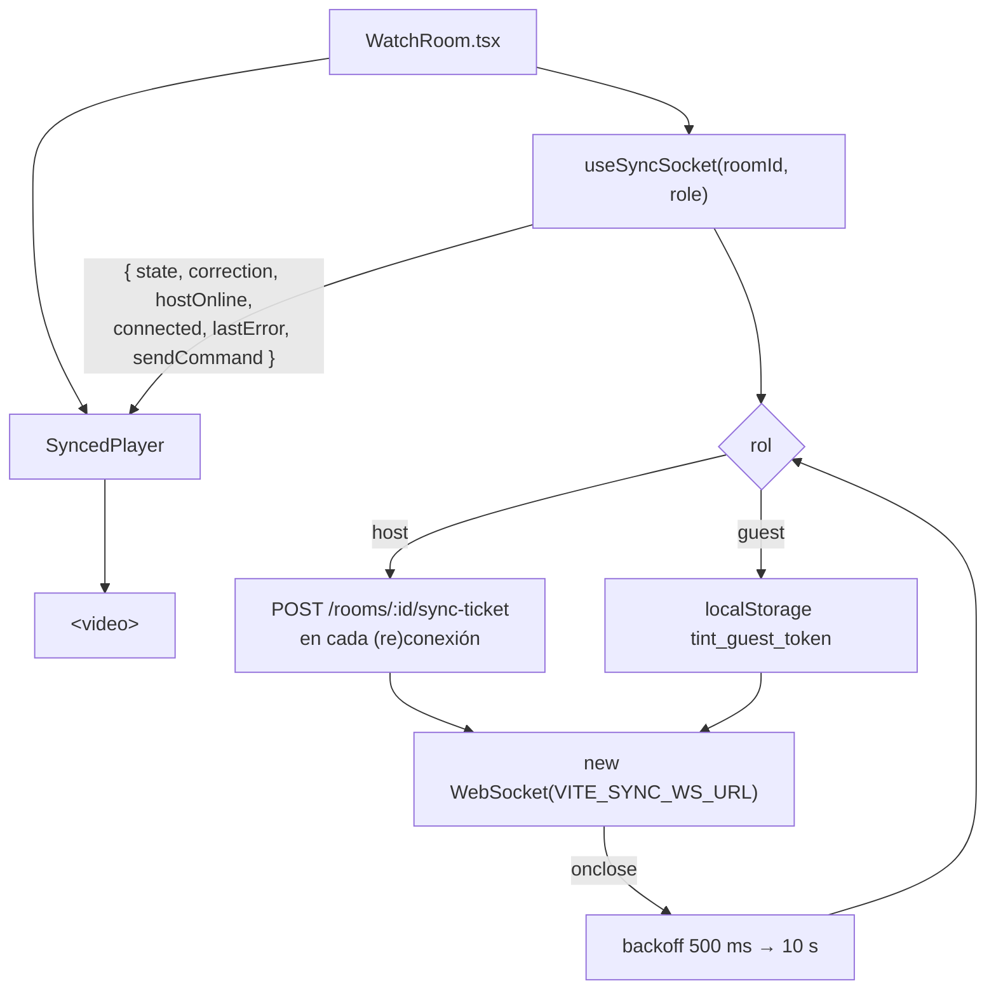

| Mensaje recibido | Acción del hook / reproductor |
| :--- | :--- |
| `STATE` | Reemplaza el snapshot (siempre) y actualiza `hostOnline`. |
| `PLAY`/`PAUSE`/`SEEK` | Se aplica solo si `version` es mayor que la local. El reproductor salta a la posición esperada y hace `play()`/`pause()`. |
| `HEARTBEAT` | Responde `SYNC_CHECK` con la posición actual del `<video>`. |
| `SYNC_CORRECTION` | `seek` → `currentTime = target`; `rate` → `playbackRate` 1.05/0.95 hasta quedar a < 100 ms o 5 s como máximo. |
| `HOST_STATUS` | Muestra u oculta la etiqueta "Host desconectado". |
| `ERROR` | Mensaje legible (`FORBIDDEN`, `RATE_LIMITED`, …). |

Si el navegador bloquea el autoplay, el reproductor muestra el botón **"Unirse a la reproducción"**. Los controles se deshabilitan para participantes y mientras no hay conexión; el servidor sigue siendo la autoridad.

---

## 10. Seguridad y límites

| Aspecto | Medida |
| :--- | :--- |
| Autenticación | JWT HS256 de identity-api; `WithValidMethods(HS256)`, `iss=tint-identity`, `aud=tint:room`, `exp` obligatorio, `sub` no vacío, `room_id` igual al de la query. Se valida **antes** del upgrade. |
| Autorización | Solo `host`/`cohost` emiten comandos; `participant` → `FORBIDDEN`. |
| Origen | `OriginPatterns` desde `ALLOWED_ORIGINS` (403 si no coincide). |
| Token en la URL | Inevitable en WebSocket de navegador; el servicio nunca registra la URL y el sync-ticket dura 10 min. |
| Tamaño | 4 KB por mensaje (cierre `1009`). |
| Frecuencia | 20 mensajes/s por conexión (`ERROR{RATE_LIMITED}`). |
| Relojes de cliente | `received_at` siempre lo sella el servidor; `ValidateInbound` no compara relojes de máquinas distintas. |
| Privacidad | `sync_drift` sin `sub`, `nick` ni token (Ley 1581). |

---

## 11. Configuración y ejecución local

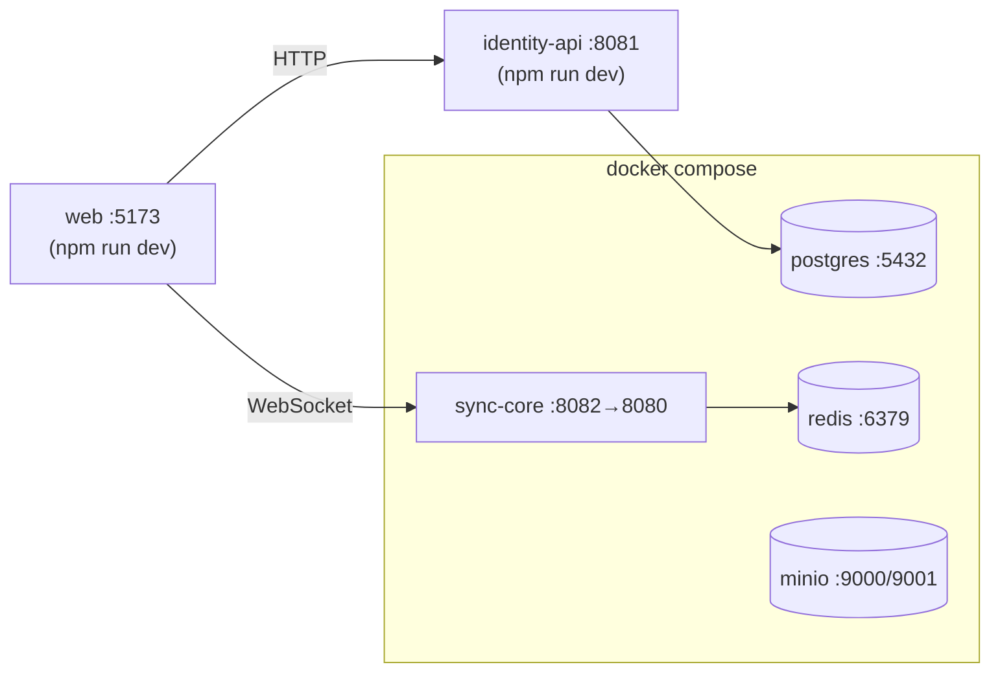

```bash
cp .env.example .env                     # JWT_SECRET compartido por identity-api y sync-core
docker compose up -d                     # postgres, redis, minio y sync-core
cd services/identity-api && npm run dev  # :8081
cd apps/web && cp .env.example .env && npm run dev   # define VITE_DEMO_VIDEO_URL
```

Abrir `/watch/:roomId` como Host en una pestaña y como invitado en otra: los comandos del Host se reflejan en el invitado.

| Variable | Servicio | Valor por defecto |
| :--- | :--- | :--- |
| `JWT_SECRET` | sync-core, identity-api | `dev-secret-change-in-prod` (**cambiar en producción**) |
| `JWT_ISSUER` / `JWT_AUDIENCE` | ambos | `tint-identity` / `tint:room` |
| `SYNC_ALLOWED_ORIGINS` → `ALLOWED_ORIGINS` | sync-core | `localhost:5173` |
| `ROOM_TTL` | sync-core | `12h` |
| `SYNC_TICKET_TTL_SECONDS` | identity-api | `600` |
| `VITE_SYNC_WS_URL` | web | `ws://localhost:8082/ws/sync` |
| `VITE_DEMO_VIDEO_URL` | web | vacío ("Sin video configurado") |

---

## 12. Verificación y resultados

| Suite | Resultado | Cobertura |
| :--- | :--- | :--- |
| sync-core (`go test -race`, `gofmt`, `go vet`) | ✅ todas pasan | **94,9 %** |
| web (Vitest) | ✅ 125 pruebas | **97,98 %** |
| identity-api (Vitest + `tsc`) | ✅ 50 pruebas | **97,85 %** |

Las pruebas de sync-core incluyen miniredis, clientes WebSocket reales, **dos hubs sobre el mismo Redis** (simulan réplicas), 20 comandos concurrentes sin pérdidas y 50 clientes concurrentes con `-race`.

**Prueba extremo a extremo con Redis real:**
- `STATE` inmediato al conectar.
- `PLAY` y `SEEK` del Host llegan al invitado en **2–4 ms**.
- `PAUSE` del invitado → `FORBIDDEN`, estado intacto.
- Invitado atrasado 11 s → `SYNC_CORRECTION` con `strategy=seek` y entrada `sync_drift` en `analytics:events` sin PII.
- Host desconectado → `HOST_STATUS online=false`; la sala sigue `playing` con `PTTL` ≈ 12 h.

**Prueba de carga k6 (500 VUs, misma máquina de 4 núcleos):**

| Umbral | Resultado |
| :--- | :--- |
| Handshakes `101` | ✅ 500/500 |
| `sync_drift_ms` p99 < 500 | ✅ 0 |
| `sync_forbidden_errors` > 99 % | ✅ 499/499 |
| `ws_connecting` p95 < 1 s | ✅ |
| `sync_broadcast_latency_ms` p99 < 100 | ❌ mediana ~18 ms, cola p99 entre 144 y 370 ms según la corrida |

Con 500 clientes escritos en Go contra el mismo servidor y Redis real, el p99 es **25 ms** y estable, y sync-core usa ~4 % de un núcleo durante la carga. Todo apunta a que la cola proviene de k6 programando 500 VUs de JavaScript en la misma máquina que el servidor, pero no está demostrado: **el umbral no se relajó** y la prueba debe repetirse con k6 en otra máquina.

---

## 13. Decisiones de diseño y desviaciones del plan

| Tema | Plan original | Implementado | Motivo |
| :--- | :--- | :--- | :--- |
| Escritura atómica | Script Lua | `WATCH/MULTI/EXEC` optimista con hasta 50 reintentos | `master.Apply` en Go sigue siendo la única fuente de verdad; no se duplica la lógica en Lua. Sigue siendo atómico entre réplicas. |
| Presencia del Host | Redis Set con TTL | ZSET con score = último latido | Permite expirar conexiones de réplicas caídas (timeout 5 s) sin TTL por miembro. |
| Validación de entrada | `Validate()` | `ValidateInbound()` para mensajes de clientes | `Validate()` rechazaba `received_at < occurred_at`, lo que expulsaría a clientes con el reloj adelantado. |
| Paquete `clock` | `Clock` inyectable | Funciones `now` inyectables por componente | Menos indirección para el mismo efecto en pruebas. |
| Lectura de estado en `SYNC_CHECK` | `HGETALL` por latido | Caché por sala alimentada por Pub/Sub | Hallazgo de la prueba de carga: saturaba el pool de go-redis. |
| Código de error `STALE` | Mensaje `ERROR` | Cierre `1008` | Un cliente que no responde latidos no leería el mensaje. |

---

## 14. Limitaciones conocidas

- **Latencia k6**: umbral p99 < 100 ms pendiente de confirmar desde una máquina separada (ver §12).
- **`make test-all`** se detiene en los servicios Python si el entorno no tiene `pytest`; no es un fallo de esta feature.
- **identity-api `npm ci`** requiere `--legacy-peer-deps` por un conflicto previo entre `vitest` y `@vitest/coverage-v8`; el CI podría fallar en ese paso.
- **Cohost en la web**: sync-core acepta `role: cohost`, pero nadie lo emite todavía y el cliente no sabe distinguirlo (vería los controles deshabilitados).
- **Usuario sin token**: en `WatchRoom`, quien no tiene guest token se trata como Host y pide un ticket (falla con 401/403 si no es el dueño).
- **Vídeo de la sala**: temporal en `VITE_DEMO_VIDEO_URL`; el vínculo sala → vídeo pertenece a media/identity.
- **Réplica caída**: no publica `HOST_STATUS offline`; la presencia expira por timeout, pero nadie avisa a los invitados hasta el siguiente evento de presencia.
- **Revocación de tokens**: no hay; un guest token sigue valiendo hasta su `exp`.
