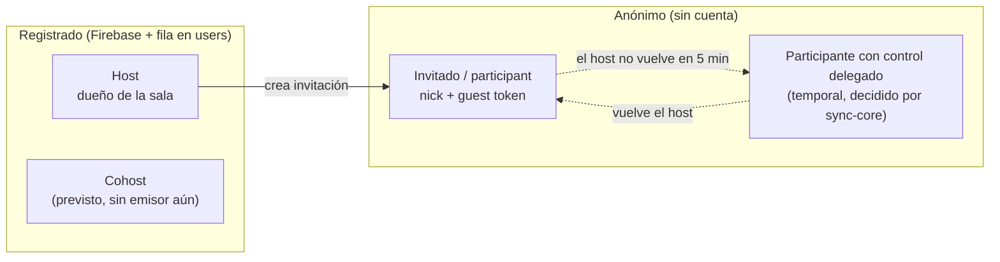
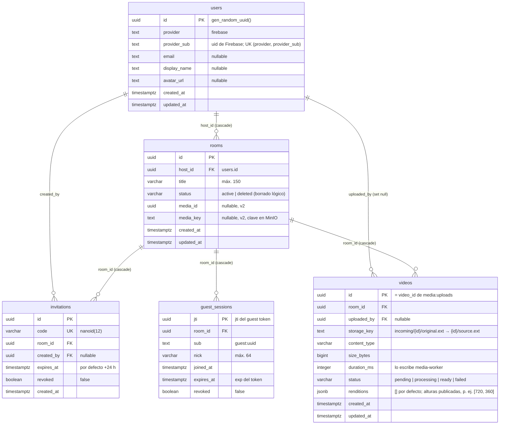
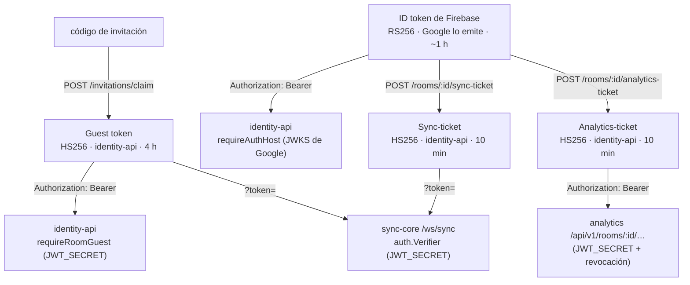
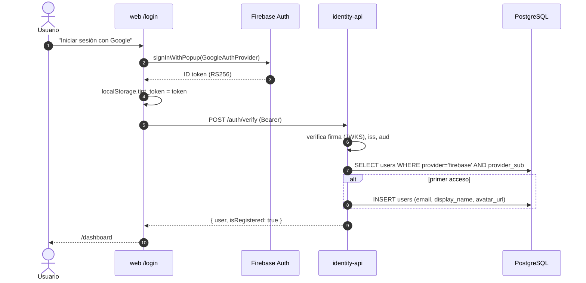
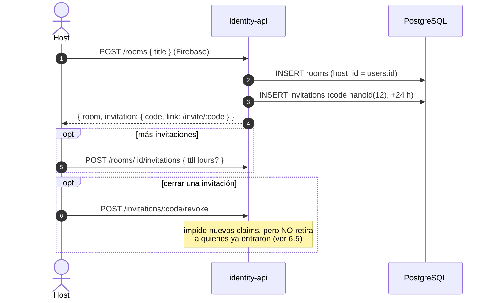
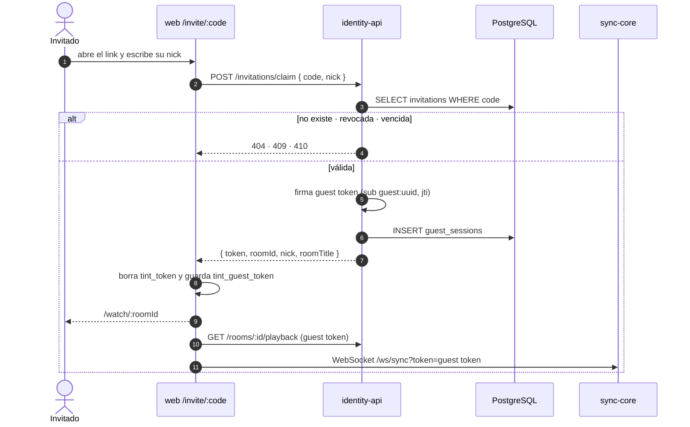
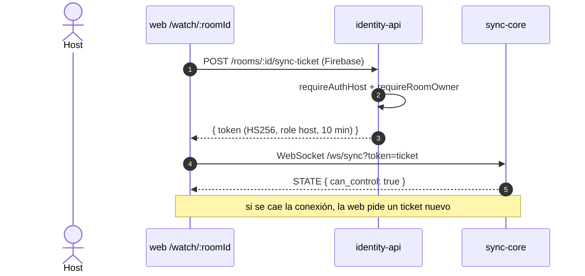
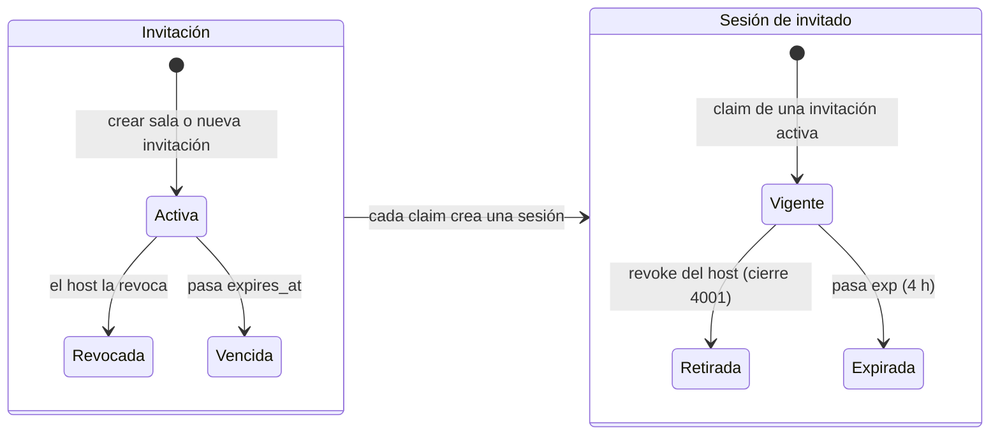
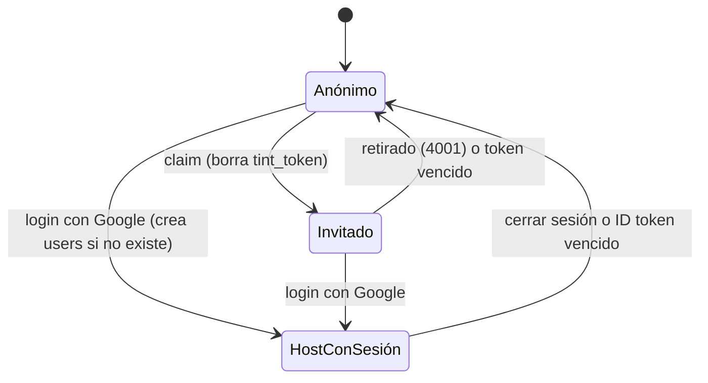

# 👤 Usuarios, identidad y permisos

> Explica quién es cada usuario en TINT, cómo se autentica, qué puede hacer y dónde se guardan sus datos.
> - Servicio dueño: [`services/identity-api`](../services/identity-api). Guía: [`services/identity-api/AGENTS.md`](../services/identity-api/AGENTS.md).
> - Los tokens los **emite** identity-api; sync-core solo los **verifica** (ver [Dominio de Reproducción](dominio-reproduccion.md)).

## Índice
1. [Tipos de usuario](#1-tipos-de-usuario)
2. [Matriz de permisos](#2-matriz-de-permisos)
3. [Esquema de datos (PostgreSQL)](#3-esquema-de-datos-postgresql)
4. [Esquemas de tokens](#4-esquemas-de-tokens)
5. [Datos de usuario fuera de PostgreSQL](#5-datos-de-usuario-fuera-de-postgresql)
6. [Flujos](#6-flujos)
7. [Ciclos de vida](#7-ciclos-de-vida)
8. [Validación en cada servicio](#8-validación-en-cada-servicio)
9. [Privacidad (Ley 1581)](#9-privacidad-ley-1581)
10. [Limitaciones conocidas](#10-limitaciones-conocidas)

---

## 1. Tipos de usuario



| Tipo | Cómo se identifica | Persistencia | Credenciales |
| :--- | :--- | :--- | :--- |
| **Host** | Cuenta de Google vía Firebase Auth. `users.id` (uuid interno) y `provider_sub` (uid de Firebase) | Fila en `users`; es dueño de `rooms` | ID token de Firebase (RS256, ~1 h) para la API; **sync-ticket** HS256 (10 min) para el Canal Sync; **analytics-ticket** HS256 (10 min) para la API de analytics |
| **Cohost** | Igual que el Host | — | sync-core acepta `role: cohost`, pero **todavía ningún endpoint lo emite** |
| **Invitado** (`participant`) | Anónimo: `sub = guest:<uuid>` y un `nick` elegido al entrar | Fila en `guest_sessions` (desde la v2) | **Guest token** HS256 (4 h), obtenido con un código de invitación |
| **Participante con control delegado** | Un invitado elegido por sync-core | Clave `room:{id}:delegate` en Redis | Su mismo guest token; el permiso lo da el servidor, no el token |

El rol **no** se guarda en la tabla `users`: se deriva del contexto.
- Host = `rooms.host_id` del usuario autenticado.
- Participante = un guest token de esa sala.
- Delegado = lo que decide sync-core en ese momento.

---

## 2. Matriz de permisos

| Acción | Host | Cohost | Invitado | Invitado delegado | Sin sesión |
| :--- | :---: | :---: | :---: | :---: | :---: |
| Iniciar sesión / `POST /auth/verify` | ✅ | ✅ | — | — | — |
| Crear sala (`POST /rooms`) y listar las suyas | ✅ | ✅ | ❌ | ❌ | ❌ |
| Ver, renombrar (`PATCH`) o borrar (`DELETE`, lógico) **su** sala | ✅ (dueño) | ❌ | ❌ | ❌ | ❌ |
| Subir vídeo (`POST /rooms/:id/media/uploads` + `complete`) | ✅ (dueño) | ❌ | ❌ | ❌ | ❌ |
| Crear o revocar invitaciones de **su** sala | ✅ | ❌ | ❌ | ❌ | ❌ |
| Reclamar invitación (`POST /invitations/claim`) | — | — | ✅ | — | ✅ (así se convierte en invitado) |
| Obtener sync-ticket | ✅ (dueño) | ❌ | ❌ | ❌ | ❌ |
| Obtener analytics-ticket (`POST /rooms/:id/analytics-ticket`), también con la sala borrada | ✅ (dueño) | ❌ | ❌ | ❌ | ❌ |
| Asignar vídeo (`PUT /rooms/:id/media`) | ✅ (dueño) | ❌ | ❌ | ❌ | ❌ |
| Ver URL de reproducción (`GET /rooms/:id/playback`) | ✅ (dueño) | ❌ | ✅ (su sala) | ✅ | ❌ |
| Listar y retirar invitados | ✅ (dueño) | ❌ | ❌ | ❌ | ❌ |
| Conectarse al Canal Sync | ✅ | ✅ | ✅ | ✅ | ❌ |
| `PLAY`/`PAUSE`/`SEEK`/`RATE`/`LOAD` | ✅ | ✅ | ❌ `FORBIDDEN` | ✅ | ❌ |
| Recibir estado, latidos y correcciones | ✅ | ✅ | ✅ | ✅ | ❌ |

> **Cohost en la API:** las rutas de sala exigen ser el **dueño** (`requireRoomOwner`). Un cohost no es dueño, así que solo podría actuar en el Canal Sync.

---

## 3. Esquema de datos (PostgreSQL)



| Tabla | Migración | Notas |
| :--- | :--- | :--- |
| `users` | `0000_shiny_quasimodo.sql` y `0005_users_provider_unique.sql` | Se crea en el primer `requireAuthHost` con un *upsert* atómico (`INSERT … ON CONFLICT (provider, provider_sub) DO UPDATE`) que en cada login refresca `email`, `display_name` y `avatar_url`. El índice único `users_provider_sub_unique` (`0005`) impide duplicados por logins concurrentes; la migración fusiona antes los duplicados existentes (conserva el más antiguo y le reasigna salas, invitaciones y vídeos). |
| `rooms` | `0000`, `0001_add-room-status.sql` y `0002_room_media.sql` | `DELETE /rooms/:id` es un **borrado lógico** (`status = 'deleted'`): la sala desaparece de los listados y sus rutas responden 410. Además revoca todas las sesiones de invitado activas (ver §6.5). Si se borra el usuario, se borran sus salas. |
| `invitations` | `0000` | El código `nanoid(12)` es la URL `/invite/:code`. Una invitación sirve para muchos invitados. |
| `guest_sessions` | `0003_guest_sessions.sql` | Una fila por guest token emitido. Permite listar y revocar. |
| `videos` | `0004_videos.sql` y `0006_video_renditions.sql` | Vídeos subidos a MinIO. identity-api crea la fila (`pending`) y, al confirmar la subida, la pasa a `processing` con un `UPDATE … WHERE status = 'pending'` (solo esa transición encola); media-worker la deja en `ready`/`failed`. `renditions` (`jsonb NOT NULL DEFAULT '[]'`, `0006`) lista las alturas de las calidades que el worker publicó en `{id}/{h}p.mp4` (`720`, `360`); identity-api ignora cualquier otro valor y las ofrece en `qualities` de `GET /rooms/:id/playback` solo si el vídeo está `ready`. |

Las migraciones se generan con `drizzle-kit generate` y se aplican con `npx drizzle-kit migrate`, usando `DATABASE_URL`.

---

## 4. Esquemas de tokens



### ID token de Firebase (Host)
Lo emite Google al iniciar sesión con `signInWithPopup` y la web lo guarda en `localStorage.tint_token`. identity-api lo verifica así:

| Verificación | Valor |
| :--- | :--- |
| Algoritmo | `RS256`, con la clave de su `kid` en el JWKS `securetoken@system.gserviceaccount.com` (en caché, 5 pedidos/min) |
| `iss` | `https://securetoken.google.com/<FIREBASE_PROJECT_ID>` |
| `aud` | `<FIREBASE_PROJECT_ID>` |
| Identidad | `sub` (o `uid`) → `users.provider_sub`; `email`, `name` y `picture` se copian en el primer acceso |

### Guest token (invitado)
```json
{
  "sub": "guest:3f2c…",          // identidad anónima, nueva en cada claim
  "room_id": "<uuid sala>",
  "role": "participant",
  "nick": "Luis",                // 1–64 caracteres
  "jti": "<uuid>",               // = guest_sessions.jti, permite revocarlo
  "iss": "tint-identity",
  "aud": "tint:room",
  "iat": 1791655200,
  "exp": 1791669600              // iat + GUEST_TOKEN_TTL_HOURS (4 h)
}
```
Se firma con HS256 y `JWT_SECRET`. La web lo guarda en `localStorage.tint_guest_token`.

### Sync-ticket (Host → Canal Sync)
```json
{
  "sub": "<users.id>",
  "room_id": "<uuid sala>",
  "role": "host",
  "nick": "display_name o email, o 'Host'",
  "jti": "<uuid>",
  "iss": "tint-identity", "aud": "tint:room",
  "iat": 1791655200, "exp": 1791655800   // + SYNC_TICKET_TTL_SECONDS (600)
}
```
No se guarda: la web pide uno nuevo en cada (re)conexión del WebSocket.

### Analytics-ticket (Host → API de analytics)
`POST /rooms/:id/analytics-ticket` (ID token de Firebase + dueño de la sala) → `{ token, expiresAt }`, igual que el sync-ticket.

- **Claims:** los mismos del sync-ticket (`sub` = `users.id`, `room_id`, `role: "host"`, `nick`, `jti`, `iss`, `aud`, `iat`, `exp`); lo firma la misma función (`generateHostTicket`).
- **Vida:** `SYNC_TICKET_TTL_SECONDS` (600 s); no se guarda, la web pide otro al caducar.
- **Salas cerradas:** la ruta no usa `requireActiveRoom`, así que el dueño también lo obtiene para una sala con borrado lógico y puede consultar sus KPIs. `requireRoomOwner` no filtra por estado.
- **Quién lo acepta:** la API de lectura de analytics exige `role: "host"` y que `room_id` coincida con la sala de la ruta, y comprueba `token:revoked:{jti}` (falla cerrado).

| | Firebase | Guest token | Sync-ticket | Analytics-ticket |
| :--- | :--- | :--- | :--- | :--- |
| Firma | RS256 (Google) | HS256 (`JWT_SECRET`) | HS256 (`JWT_SECRET`) | HS256 (`JWT_SECRET`) |
| Vida | ~1 h | 4 h | 10 min | 10 min |
| `role` | — | `participant` | `host` | `host` |
| Revocable | En Firebase | ✅ (`guest_sessions` + `token:revoked:{jti}`) | No (vida corta) | No (vida corta) |
| Dónde vive en la web | `localStorage.tint_token` | `localStorage.tint_guest_token` | Memoria | Memoria |

> `JWT_SECRET`, `JWT_ISSUER` y `JWT_AUDIENCE` **deben ser idénticos** en identity-api y sync-core.

---

## 5. Datos de usuario fuera de PostgreSQL

| Dónde | Clave | Contenido | Vida |
| :--- | :--- | :--- | :--- |
| Redis | `token:revoked:{jti}` | Marca de token revocado | Hasta el `exp` del token |
| Redis | `room:{id}:members` | `sub` de invitados conectados (ZSET por último latido) | 12 h; cuenta 5 s |
| Redis | `room:{id}:hosts_online` | Ids de conexión de host/cohost | 12 h; cuenta 5 s |
| Redis | `room:{id}:delegate` | `sub` del invitado con control | 12 h |
| Redis | `room:{id}:sync_state.host_id` | `sub` del último Host conectado | 12 h |
| Redis Stream | `analytics:events` | Eventos de analítica ([contrato](contrato-eventos-analitica.md)). Los de identity-api (`user_login`, `room_created`, `room_closed`, `invitation_claimed`) llevan como `user_id` el `sub` (`provider_sub` o `guest:<uuid>`), nunca email, nombre, `nick` ni token; los de sync-core (`playback_command`, `drift_correction`, `buffering`) van **sin** `sub`, `nick` ni token | `MAXLEN ~100000` |
| Navegador | `localStorage.tint_token` / `tint_guest_token` | Tokens del usuario | Hasta cerrar sesión, revocación (4001) o expiración |
| Navegador | `localStorage.tint_room_title` / `tint_invite_link` | Título y link que recibe el invitado al reclamar la invitación (el invitado no puede pedirlos a la API de host) | Hasta el siguiente claim |

---

## 6. Flujos

### 6.1 Registro e inicio de sesión del Host



No hay un paso de registro aparte: **el primer inicio de sesión crea la cuenta**.

### 6.2 Crear sala e invitar



### 6.3 Un invitado entra a la sala



### 6.4 El Host entra a su sala



### 6.5 Retirar a un invitado

Ver la secuencia completa en [Dominio de Reproducción §6.6](dominio-reproduccion.md#66-retirar-a-un-invitado-f5). En resumen:
1. `POST /rooms/:id/guests/:jti/revoke` marca `guest_sessions.revoked`.
2. Escribe `token:revoked:{jti}` en Redis y publica `REVOKED`.
3. sync-core cierra la conexión con código `4001`, y el token deja de servir en la API y en el canal.

**Borrar la sala** (`DELETE /rooms/:id`) hace lo mismo con todas sus sesiones no revocadas y no vencidas: `SET token:revoked:{jti}` + `REVOKED` por cada `jti` y, solo cuando Redis lo acepta todo, `guest_sessions.revoked = true`. Falla cerrado: si Redis falla, la sala queda borrada pero se responde **503**; repetir el `DELETE` sobre la sala ya borrada vuelve a revocar las sesiones pendientes y responde 410.

---

## 7. Ciclos de vida





---

## 8. Validación en cada servicio

| Servicio | Middleware / componente | Qué acepta |
| :--- | :--- | :--- |
| identity-api | `requireAuthHost` | ID token de Firebase válido; crea o recupera `req.user` |
| identity-api | `requireRoomOwner` | `rooms.host_id === req.user.id` para `:id` |
| identity-api | `requireRoomGuest` | Guest token HS256 de la sala `:id`, `role: participant`, `jti` no revocado (503 si no se puede comprobar) |
| identity-api | `requireRoomHostOrGuest` | Elige según el `alg` del JWT: `HS256` → invitado; en otro caso → host dueño |
| sync-core | `auth.Verifier` + `ws.Handler` | HS256 con `iss`/`aud`/`exp`/`sub`/`room_id`; rol `host`/`cohost`/`participant`; `jti` no revocado |
| web | `ProtectedRoute` | Exige `tint_token` para `/dashboard` y `/rooms/new` (la autoridad real es la API) |

Respuestas de error de identity-api: `{ "error": "<texto>" }`. Los 400 de zod añaden `details`.

---

## 9. Privacidad (Ley 1581)

- **Datos personales guardados:** solo los del Host (`email`, `display_name`, `avatar_url`) y el `nick` del invitado en `guest_sessions`.
- **El invitado es anónimo:** su `sub` es un uuid aleatorio por cada claim y no se vincula con ninguna cuenta.
- **Analítica:** `analytics:events` nunca lleva `sub`, `nick`, email ni tokens. El servicio de analítica descarta además los campos de texto libre (`sanitize.py`).
- **`GET /rooms/:id/guests`** no expone el `sub`.
- **Borrado en cascada:** al borrar un usuario se borran sus salas, y con ellas sus invitaciones y sesiones de invitado.

---

## 10. Limitaciones conocidas

| Tema | Situación actual | Riesgo |
| :--- | :--- | :--- |
| Unicidad de `users` | No hay índice `UNIQUE (provider, provider_sub)`; el *upsert* es "buscar y luego insertar" | Dos primeros inicios de sesión simultáneos podrían duplicar al usuario |
| Perfil desactualizado | El *upsert* no actualiza `email`/`display_name`/`avatar_url` si cambian en Google | Datos viejos en `users` |
| ID token de Firebase | Se guarda en `localStorage` y no se renueva solo (~1 h) | Al vencer, la API responde 401 y hay que volver a iniciar sesión |
| Cohost | sync-core lo acepta, pero no hay endpoint ni UI que lo emita | Funcionalidad incompleta |
| Revocar una invitación | No retira a los invitados que ya entraron con ella | Hay que retirarlos uno por uno |
| CORS | `cors()` sin lista de orígenes | Conviene restringirlo en producción |
| Manejador de errores | Devuelve `err.message` en los 500 | Puede filtrar detalles internos |
| Usuario sin token en `/watch` | La web lo trata como Host y pide un ticket (falla si no es el dueño) | Mensaje de error poco claro |
